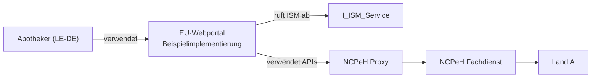

# C4 - System Context Diagram

## Zweck

Dieses Diagramm beschreibt den Kontext der Beispielimplementierung des EU-Webportals im Land-B-Szenario.

Der Fokus liegt auf den externen Systemen und Akteuren, mit denen das EU-Webportal kommuniziert.

---

## Scope MVP 1

Im MVP 1 wird ausschließlich die Anbindung des ISM-Service betrachtet. Die
WebApp zeigt die ISM-Suchmasken für Frankreich und Polen an. Nutzer können
Eingaben vornehmen; ein in der jeweiligen ISM-Beschreibung angegebener Regex
wird während der Eingabe zur Prüfung des Feldwerts verwendet. Die Suchanfrage
wird nicht abgesendet.

Nicht Bestandteil:

- Authentisierung
- Autorisierung
- ASL-Kommunikation
- Rezeptabruf
- Dispensierung

---

## Zielarchitektur



---

## Akteure

### Apotheker (LE-DE)

Nutzt das EU-Webportal zur Durchführung grenzüberschreitender E-Rezept-Prozesse.

---

## Systeme

### EU-Webportal

Beispielimplementierung des Land-B Web Clients.

Verantwortlichkeiten:

- Benutzerführung
- Darstellung von Suchmasken
- Darstellung von Rezeptinformationen
- Durchführung von Dispensierungen
- Kommunikation mit dem NCPeH-Proxy

---

### I_ISM_Service

Liefert länderspezifische Suchmasken (International Search Mask).

Verantwortlichkeiten:

- Bereitstellung von Suchfeldern
- Beschreibung von Validierungsregeln
- Bereitstellung von Metadaten

---

### NCPeH Proxy

Zentraler Kommunikationspartner des EU-Webportals.

Verantwortlichkeiten:

- Authentisierung
- Autorisierung
- Token-Verwaltung
- Weiterleitung von Anfragen

---

### NCPeH Fachdienst

Fachliche Verarbeitung der Land-B-Anwendungsfälle.

Verantwortlichkeiten:

- Kommunikation mit europäischen NCPeH-Systemen
- Dokumententransformationen
- Fachlogik

---

### Land A

EU-Mitgliedstaat des Patienten.

Verantwortlichkeiten:

- Bereitstellung von Patientendaten
- Bereitstellung von Rezeptdaten
- Entgegennahme von Dispensierinformationen
```