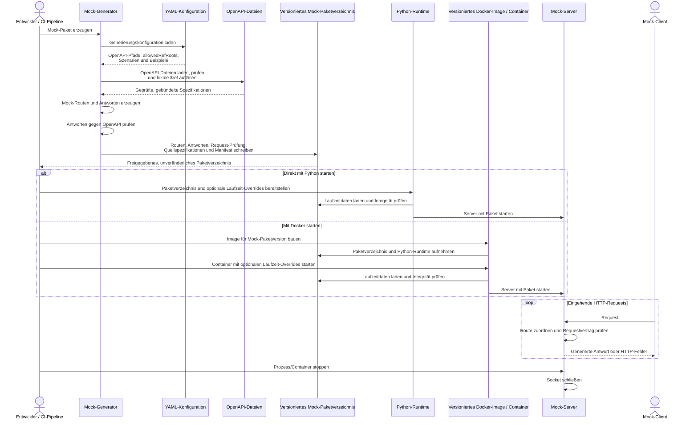
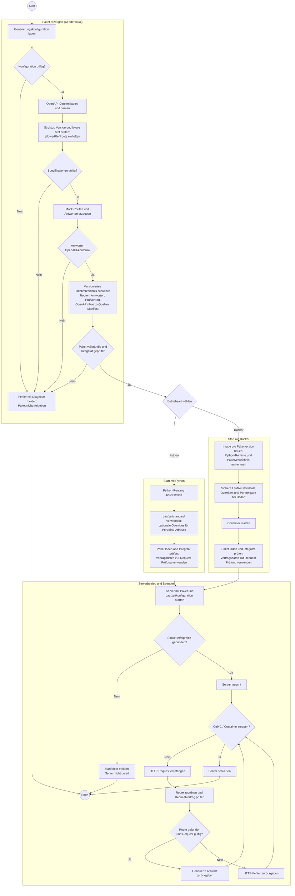

# Mock-Verarbeitungsablauf

## Zweck und Abgrenzung

Die UML-Diagramme zeigen den angestrebten Ablauf: Ein versioniertes,
eigenständig ausführbares Mock-Paket wird einmal aus OpenAPI-Artefakten
erzeugt und geprüft. Danach kann es direkt mit Python oder zusammen mit der
Server-Runtime in einem Docker-Image betrieben werden.

Das Diagramm zeigt **OpenAPI -> Mock**, nicht die im
[ADR-0011](../adr/ADR-0011-kanonisches-ism-modell.md) vorgeschlagene
Verarbeitung **ISM-XML -> Canonical ISM Model -> HTML**. Diese
ISM-Generatorpipeline ist in diesem Repository noch nicht implementiert.
Arazzo-Workflows werden von `start-mocks` ebenfalls nicht ausgeführt oder
benötigt. Für Workflow-Validierung gibt es separate CLI-Befehle.

## Ziel: Sequenzdiagramm



Das Paket ist ein unveränderliches, semantisch versioniertes Verzeichnis.
Es enthält mindestens vorab erzeugte Routen und Antworten, alle für die
Request-Prüfung nötigen Vertragsdaten, die vollständigen versionierten
OpenAPI-/Arazzo-Quelldefinitionen zur Nachvollziehbarkeit sowie ein Manifest
mit Quell-/Generatorversionen und Prüfsummen. Die Laufzeit liest die
Vertragsdaten, wertet aber weder OpenAPI/Arazzo noch Generierungsregeln erneut
aus. Arazzo dient hier der Dokumentation und Nachschlagbarkeit; der Mockserver
führt keine Workflows aus.

Die Generator-Konfiguration (Quellpfade, Referenzfreigaben und
Beispiel-/Szenarioauswahl) ist von der Laufzeitkonfiguration getrennt.
Bind-Adresse und Port gehören zur Laufzeit und können mit sicheren
Standardwerten gestartet sowie ausdrücklich überschrieben werden.

## Ziel: Aktivitätsdiagramm

Das Diagramm zeigt die gewünschte Trennung von Erzeugung und Betrieb. Erst
wird das Paket aus Konfiguration und OpenAPI erstellt und geprüft; danach
kann dasselbe Paket lokal durch Python oder in einem Docker-Container
gestartet werden.



Docker erhält das Paketverzeichnis und die Python-Runtime. Generierungsquellen
und Generator-Konfiguration werden zur Laufzeit nicht benötigt. Ein
Docker-Image wird pro Paketversion gebaut. Für Hostzugriff sind eine
Portveröffentlichung und `mock.bindHost: 0.0.0.0` im Container erforderlich;
dieser externe Zugriff muss bewusst aktiviert werden.

**Umsetzungsstand:** Paketexport und direkter Start des Pakets mit Python
werden unterstützt. `start-mocks --package-dir` lädt geprüfte Laufzeitdaten;
die OpenAPI-/Arazzo-Quellen werden nicht erneut ausgewertet.
`Dockerfile.mock` baut ein Image pro Paketversion. Imagebau und
Containerbetrieb wurden am 2026-10-06 mit der Demo-Konfiguration abgenommen:
HTTP 200 für gültige Requests, HTTP 400 bei Vertragsverletzungen und HTTP 404
bei unbekannten Routen. Der Server läuft ohne Quellmounts, mit
schreibgeschütztem Dateisystem und ohne Root-Rechte.

## Paketstart ohne Docker

Der CLI-Prozess läuft direkt auf dem Entwicklungsrechner. Konfigurations- und
OpenAPI-Pfade werden relativ zum aktuellen Arbeitsverzeichnis aufgelöst.

```powershell
uv run python -m tools.openapi_arazzo_tool.cli start-mocks --package-dir .\dist\mock-1.0.0
```

Standardmäßig ist der Mock unter `http://127.0.0.1:8080` erreichbar.
Laufzeitoptionen können überschrieben werden, zum Beispiel:

```powershell
uv run python -m tools.openapi_arazzo_tool.cli start-mocks --package-dir .\dist\mock-1.0.0 --port 9090
```

Der Prozess bleibt im Vordergrund; `Ctrl+C` beendet ihn und schließt den
Server. Externe Bindung muss ausdrücklich mit `--bind-host 0.0.0.0` aktiviert
werden.

## Versioniertes Docker-Image

Image pro semantischer Paketversion bauen:

```powershell
docker build --build-arg MOCK_PACKAGE_DIR=dist/mock-1.0.0 --build-arg MOCK_PACKAGE_VERSION=1.0.0 --tag euwp-mock:1.0.0 --file Dockerfile.mock .
```

Build validiert Paketmanifest, Prüfsummen und Übereinstimmung der Paketversion
mit der Imageversion. Das Image enthält Python-Runtime, Server und
Paketverzeichnis, aber keine OpenAPI-/Arazzo-Quellen außerhalb des Pakets.

Container ohne Host-Portfreigabe starten:

```powershell
docker run --rm --read-only --tmpfs /tmp euwp-mock:1.0.0
```

Der Container verwendet dieselben Laufzeitdefaults wie Python
(`127.0.0.1:8080`), sodass ohne explizite Bind- und Portoptionen kein Zugriff
von außerhalb des Containers vorgesehen ist. Für Hostzugriff muss die
Bind-Adresse innerhalb des Containers auf `0.0.0.0` gesetzt und der
veröffentlichte Hostport explizit an Loopback gebunden werden:

```powershell
docker run --rm --read-only --tmpfs /tmp -p 127.0.0.1:8080:8080 euwp-mock:1.0.0 start-mocks --package-dir /opt/mock-package --bind-host 0.0.0.0 --port 8080
```

Das Image veröffentlicht keine Ports von selbst. `0.0.0.0` öffnet den
Listener innerhalb der Container-Netzwerkschnittstellen; die explizite
Portzuordnung zum Host ist erforderlich und sollte auf Loopback begrenzt
bleiben. Andere Netzwerkeinstellungen sind bewusste Betreiber-Overrides.

Über `just`:

```powershell
just docker-build-mock .\dist\mock-1.0.0 1.0.0
```

Das vorhandene `docker compose`-Toolimage bleibt für Validierungs- und
Workflowbefehle erhalten. Es ist nicht das versionierte Mock-Serverimage.

## Reproduzierbarer Demolauf

Die mitgelieferte Konfiguration nutzt ausschließlich Repository-Fixtures;
ein externes `api-ncpeh`-Checkout ist nicht erforderlich. Aus dem
Repository-Root:

```powershell
uv run python -m tools.openapi_arazzo_tool.cli generate-mocks --config .\tools\mock-package-demo.yaml --output .\dist\mock-demo-1.0.0
just docker-build-mock .\dist\mock-demo-1.0.0 1.0.0
docker run --rm --read-only --tmpfs /tmp -p 127.0.0.1:8080:8080 euwp-mock:1.0.0 start-mocks --package-dir /opt/mock-package --bind-host 0.0.0.0
```

In einem zweiten Terminal:

```powershell
curl.exe -i "http://127.0.0.1:8080/widgets/demo?locale=de-DE"
curl.exe -i "http://127.0.0.1:8080/widgets/demo"
curl.exe -i "http://127.0.0.1:8080/widgets/demo?locale=invalid"
curl.exe -i "http://127.0.0.1:8080/unknown"
```

Erwartet werden nacheinander HTTP 200, 400, 400 und 404. Die gültige
Fixture-Antwort enthält absichtlich keinen Body. `Ctrl+C` oder
`docker stop <Container-ID>` beendet den Server sauber; bei `docker stop`
ist Exit-Code 0 erwartet. Das Paketverzeichnis darf bei erneuter Generierung
nicht bereits existieren; für neue Lieferstände eine neue Paketversion und
ein neues Ausgabeverzeichnis verwenden.
