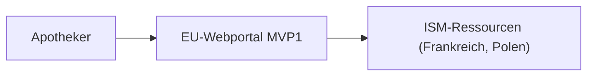

# MVP1

## Ziel

Nachweis der technischen Machbarkeit des Use Cases
"8.5.3.1 International Search Masks abrufen"

## Success Criteria

- ISM-Beschreibungen für Frankreich und Polen bereitstellen
- Für jedes Land die zugehörige ISM-Suchmaske anzeigen
- Eingaben in den Suchmasken ermöglichen
- Einen in der ISM angegebenen Regex beim Eingeben zur Prüfung des Feldwerts
  verwenden
- Suchanfrage nicht absenden

## Nicht Bestandteil

- Login
- Authentisierung
- ASL
- Patientenidentifikation
- Rezeptsuche
- Absenden der Suchanfrage
- Dispensierung

## MVP 1 (aktuelle Umsetzung)

